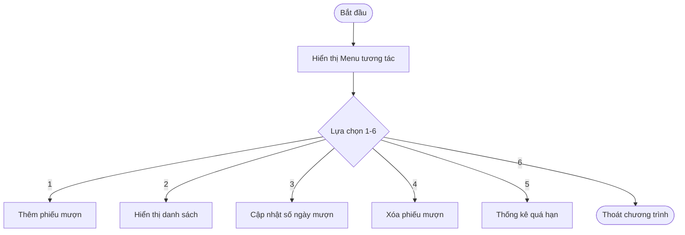

# Báo cáo bài tập lập trình C - Module Quản lý Mượn Sách & Quyết toán Tiền Phạt WMS

> 👤 **Học viên:** Hoàng Công Dũng | **Mã SV:** PTIT-HCM-009
> 🏫 **Môn học:** it102-rl-hoangcongdung

---

## 📊 Sơ đồ thiết kế hệ thống (Flowchart)

> 💡 *Sơ đồ dưới đây được render tự động trực tiếp trên GitHub bằng Mermaid. Bạn cũng có thể tải file **`bt2.drawio`** trong repository này để mở và chỉnh sửa trực tiếp trên [Draw.io (diagrams.net)](https://app.diagrams.net).* 

---

## 1. Mục tiêu và Bối cảnh bài toán

Bài thực hành này giúp củng cố kiến thức về mảng song song (Parallel Arrays), thao tác CRUD trên mảng ký tự và số nguyên trong ngôn ngữ C.

Hệ thống LIBRARY_WMS quản lý thông tin phiếu mượn, tính toán tiền phạt tự động dựa trên số ngày mượn vượt quá quy định 14 ngày với mức phạt 5.000 VNĐ / ngày / quyển.

- Sử dụng mảng song song maPhieu, tenSach, soNgayMuon, tienPhat cùng chỉ số quản lý.
- Xử lý trôi lệnh bàn phím khi kết hợp scanf và fgets.
- Ứng dụng thuật toán dồn mảng khi thực hiện xóa phần tử.

## 2. Triển khai kỹ thuật và Xử lý ngoại lệ

Chương trình sử dụng vòng lặp do-while kết hợp switch-case để tạo menu tương tác liên tục trên terminal.

Các trường hợp ngoại lệ như mảng đầy, trùng lặp mã phiếu, không tìm thấy mã khi cập nhật hoặc xóa đều được kiểm tra và thông báo rõ ràng.

- Kiểm tra trùng mã phiếu bằng strcmp trước khi thêm mới.
- Làm sạch bộ đệm bàn phím bằng while (getchar() != '
'); trước khi nhận chuỗi có dấu cách.
- Cập nhật lại tiền phạt ngay khi số ngày mượn được chỉnh sửa.

---

## 📁 Danh sách tệp tin nộp bài trong Repository
- 📝 `bt2.docx`: Báo cáo tài liệu phân tích nghiệp vụ hoàn chỉnh.
- 🎨 `bt2.drawio`: File thiết kế sơ đồ chuẩn theo quy định đề bài (mở trực tiếp bằng [Draw.io](https://app.diagrams.net) hoặc Lucidchart).
- 💻 `main.c`: Mã nguồn chương trình.
